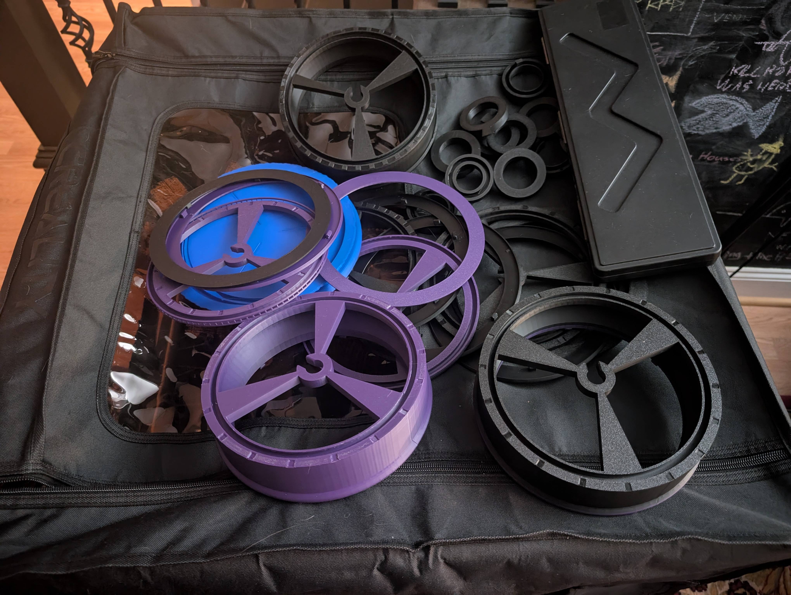
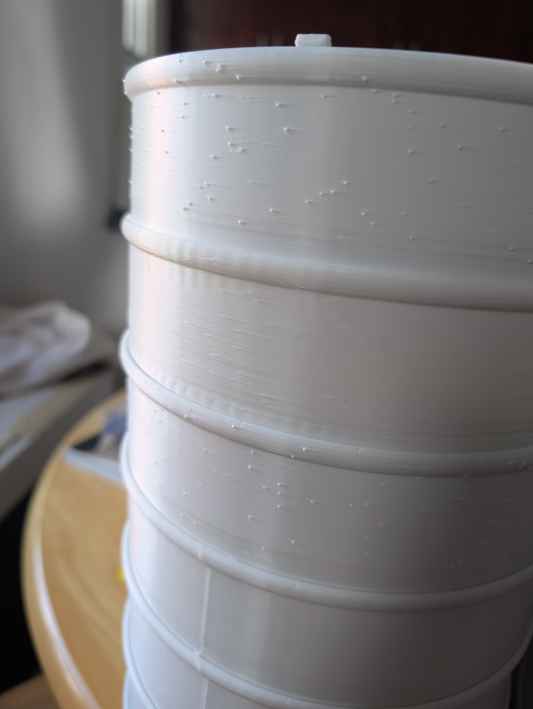
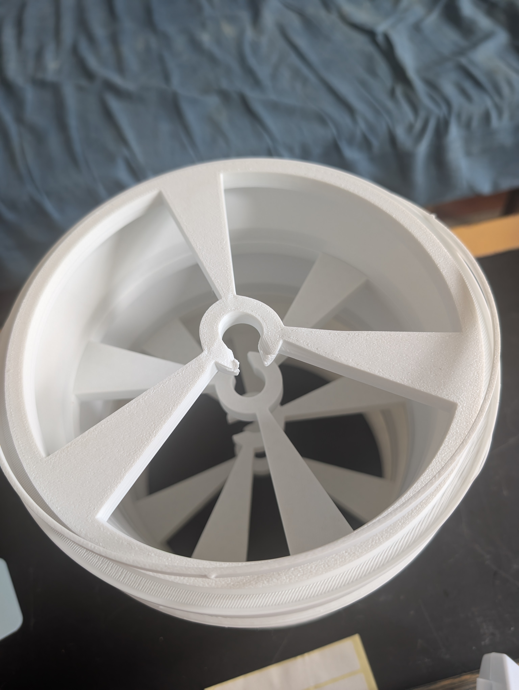
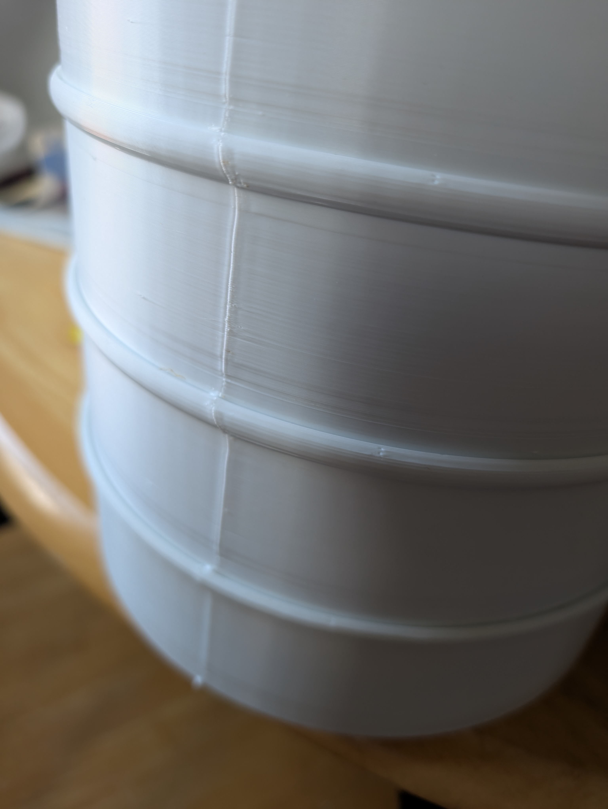
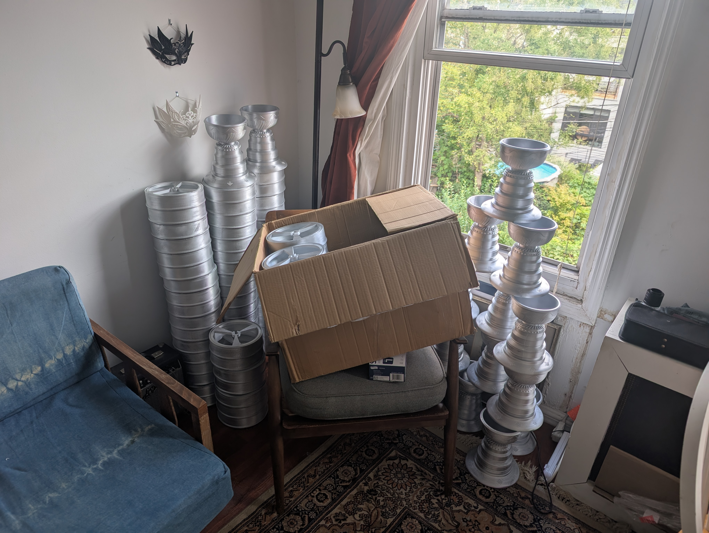
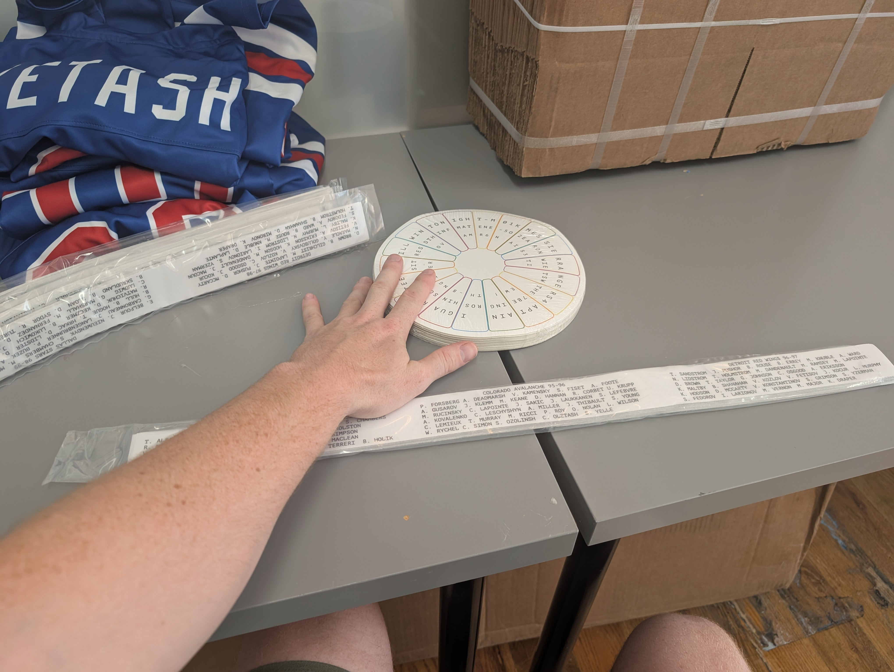
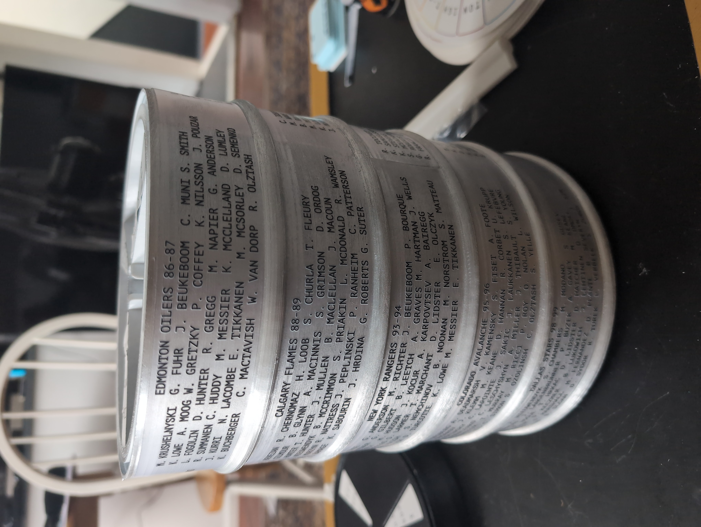
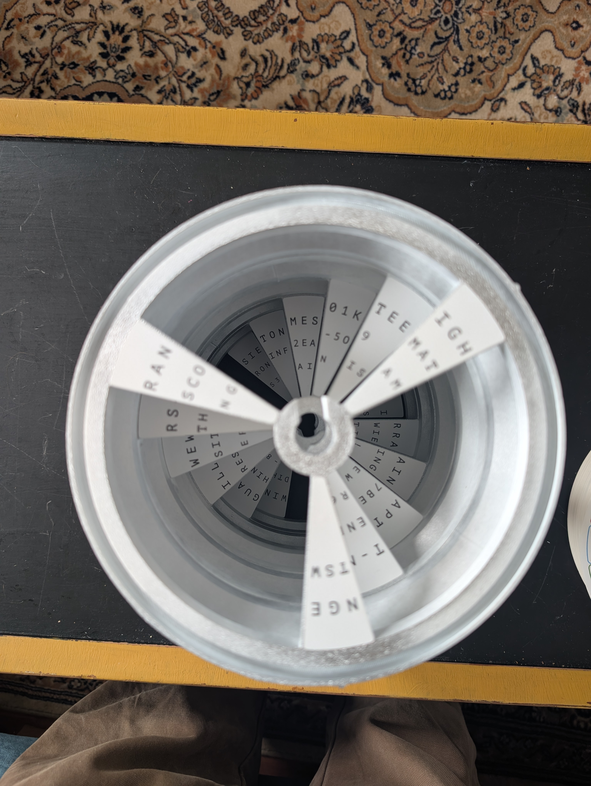
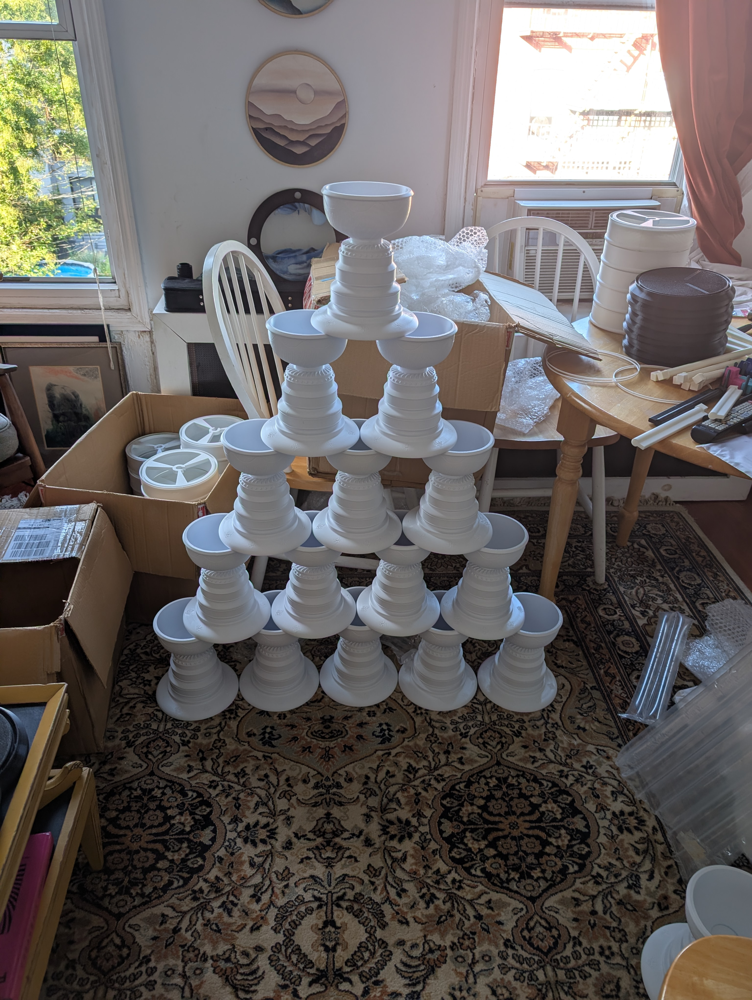
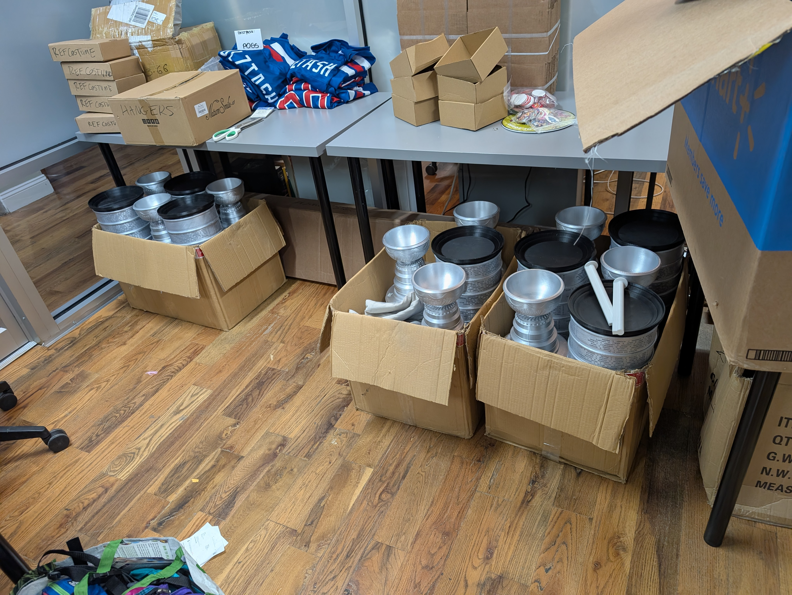

## Problem
Gotham Immersive Labs contracted me to build them a puzzle involving the Stanley Cup for [Midnight Madness](https://midnightmadness.nyc/), a charity event that last year raised $818K!
## Process
After staring at pictures of the Stanley Cup for a bit, I became enraptured with the idea of making the entire thing into a gigantic [cryptex](https://fr.wikipedia.org/wiki/Cryptex). This idea evolved into having a second puzzle on the inside, where the player must unscramble the discs again to form another phrase. I was also challenged to make the design work without other hardware being installed, and be toleranced well enough that print farm prints would still function.

Getting the discs to snap together and still rotate with the right amount of friction was the largest hurdle. A few days of rapidly prototyping different tolerances and mechanisms were required to nail that function down. I studied existing crypteces (I've decided that's what the plural should be) to understand how the mechanism traditionally works, and adapted it easily for the cup. I used steel dowels as teeth to the "key" to prevent players from snapping the key by over-pulling.

I used many images of the real Stanley Cup to make this version as accurate as possible, down to detailing on the bowl. After some research, I found a metallic silver Rust-Oleum spray paint to match the color of the original as well.

After printing out a working copy, I sent off for 17 cups to be printed by a large print farm. To be honest, I was not thrilled by the results. Some misprints, damage, and major pitting marred the pieces, as well as major seams that needed to be sanded.

Repairing and sanding the pieces down took a few days of boring labor, but the finished painted results were worth the effort.

Meanwhile, Ryan from Gotham Immersive Labs developed the stickers that would act as the puzzle for the cup. On the outside, winning teams and player names would be spaced such that a key phrase could be read down the entire assembly when the discs have been aligned correctly. The phrase 'the metal inside that makes a champion' would be given as the result to the previous puzzle. 
On the inside, the support pillars would be arranged to form three different hockey sayings, followed by the player who said them. 10 letters had been replaced with numbers, which when put in order, spelled out the name of the next location for players to go to.

## Result
Midnight Madness 2026 was an absolute smash hit. We haven't heard the total for charity yet, but 21 teams participated at $24K a pop. The whole hockey puzzle was much loved, with at least one team running off with their prize for their own collection!

I'll donate one tower to the VT Hunt, maybe they'll do something cool with the idea.

